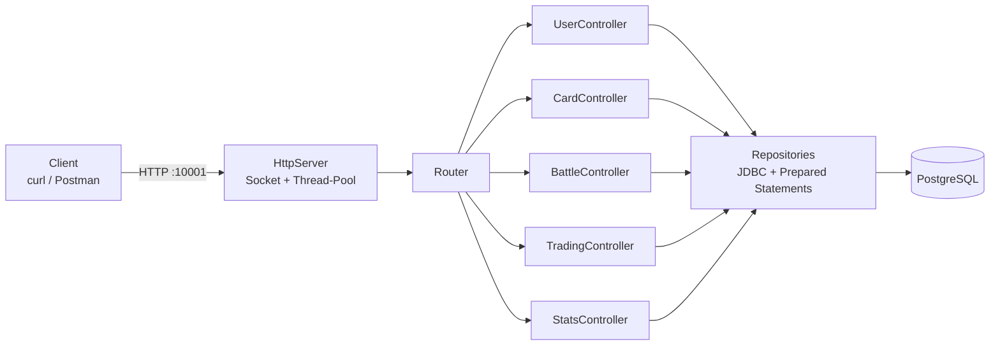
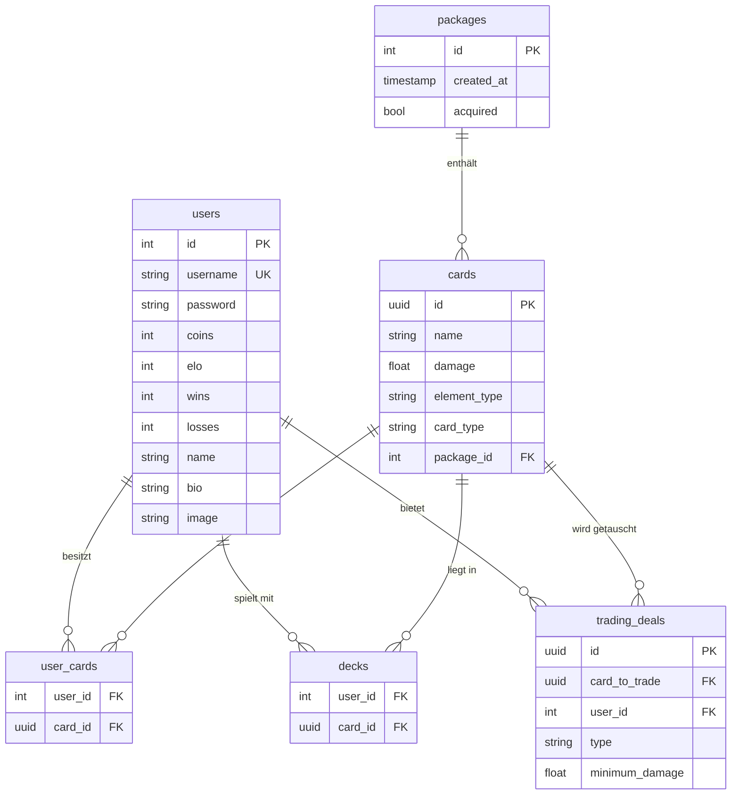

<div align="center">

# Monster Trading Cards Game (MTCG)

**REST-Server für ein Sammelkarten-Spiel – komplett ohne Web-Framework, mit eigenem HTTP-Server in Java**


[](https://github.com/if23b152/MTCG/actions/workflows/ci.yml)

</div>

---

Spieler registrieren sich, kaufen Kartenpakete, stellen ein Deck aus vier Karten zusammen und treten in Kämpfen gegeneinander an. Gewinne und Niederlagen verändern das **ELO-Rating**, Karten können auf einem **Handelsplatz** getauscht werden.

Das Besondere: Der HTTP-Server ist **selbst implementiert** – Socket-Handling, Request-Parsing, Routing und Thread-Pool, ohne Spring oder ähnliche Frameworks.

## Inhalt

- [Features](#features)
- [Architektur](#architektur)
- [Spielregeln](#spielregeln)
- [Schnellstart](#schnellstart)
- [API](#api)
- [Datenbank](#datenbank)
- [Tests](#tests)
- [Sicherheit](#sicherheit)
- [Projektstruktur](#projektstruktur)

## Features

| Bereich | Funktionen |
|---|---|
| 👤 Benutzer | Registrierung, Login, Profil (Name, Bio, Bild) bearbeiten |
| 🃏 Karten | Pakete à 5 Karten (Admin), Pakete kaufen (5 Coins), eigene Karten anzeigen |
| 🛡️ Deck | Deck aus genau 4 eigenen Karten konfigurieren und anzeigen |
| ⚔️ Kampf | Matchmaking zweier Spieler, max. 100 Runden, ausführliches Battle-Log |
| 📈 Statistik | ELO, Siege, Niederlagen, Scoreboard sortiert nach ELO |
| 🔄 Handel | Tauschangebote erstellen, anzeigen, löschen und annehmen |

## Architektur



- **Schichten:** Server (HTTP, Routing) → Controller (Request-Logik) → Repository (Datenbankzugriff) → Models (Domäne)
- **Nebenläufigkeit:** fester Thread-Pool mit 10 Workern, jede Verbindung wird in einem eigenen Task verarbeitet
- **Routing:** Methode + Pfad inkl. Pfadparameter (`/users/{username}`, `/tradings/{tradingdealid}`)
- **Persistenz:** reines JDBC mit Prepared Statements, Schema in [`init.sql`](init.sql)

Ein Sequenzdiagramm des Kampfablaufs liegt unter [`UML/MTCG.puml`](UML/MTCG.puml), das Projektprotokoll unter [`Protokoll/MTCG.pdf`](Protokoll/MTCG.pdf).

## Spielregeln

1. Jeder Spieler startet mit **20 Coins** und **100 ELO**.
2. Ein Paket kostet **5 Coins** und enthält **5 Karten**.
3. Pro Runde zieht jeder Spieler eine zufällige Karte aus seinem Deck. Die stärkere Karte gewinnt, die unterlegene wechselt ins Deck des Siegers.
4. Ein Kampf endet, wenn ein Deck leer ist oder nach **100 Runden** (Unentschieden).
5. **Booster:** Pro Runde erhält je eine zufällige Karte jedes Spielers +50 % Schaden.

**Element-Effektivität** (Multiplikator auf den Schaden)

| Angreifer → Verteidiger | Faktor |
|---|---|
| Water → Fire · Fire → Normal · Normal → Water | ×2.0 |
| gleiches Element | ×1.0 |
| alle anderen Kombinationen | ×0.5 |

**Spezialfälle**

| Situation | Effekt |
|---|---|
| Goblin greift Dragon an | Goblin hat Angst – 0 Schaden |
| Knight gegen WaterSpell | Knight ertrinkt – 0 Schaden |
| Kraken gegen Spell | Kraken ist immun gegen Zauber |

**ELO:** Klassische ELO-Formel mit K-Faktor 32 – ein Sieg gegen einen stärkeren Gegner bringt mehr Punkte.

## Schnellstart

**Voraussetzungen:** Java 17+, Maven, Docker

```bash
# 1. Datenbank starten (Schema wird über init.sql automatisch angelegt)
docker compose up -d

# 2. Server bauen und starten
mvn compile exec:java
```

Der Server läuft anschließend auf **http://localhost:10001**.

**Konfiguration** über Umgebungsvariablen (Defaults für lokale Entwicklung):

| Variable | Default |
|---|---|
| `MTCG_DB_URL` | `jdbc:postgresql://localhost:5432/mtcg` |
| `MTCG_DB_USER` | `postgres` |
| `MTCG_DB_PASSWORD` | `0000` |
| `MTCG_DB_PORT` | `5432` – nur für `docker compose`, wenn der Port lokal schon belegt ist (dann auch `MTCG_DB_URL` anpassen) |

> Für alles außer lokaler Entwicklung ein eigenes Passwort setzen – `docker compose` liest `MTCG_DB_PASSWORD` ebenfalls.
>
> Die Datenbank läuft auf PostgreSQL 17. Ein altes Volume einer anderen Version lässt sich mit `docker compose down -v` zurücksetzen (löscht alle Daten).

## API

Authentifizierung erfolgt über den Header `Authorization: Bearer <username>-mtcgToken`, den `POST /sessions` zurückliefert. Pakete anlegen darf nur `admin`.

| Methode | Pfad | Auth | Beschreibung |
|---|---|:---:|---|
| `POST` | `/users` | – | Benutzer registrieren |
| `POST` | `/sessions` | – | Login, liefert Token |
| `GET` | `/users/{username}` | ✅ | Profil abrufen (nur eigenes) |
| `PUT` | `/users/{username}` | ✅ | Profil bearbeiten |
| `POST` | `/packages` | 🔑 admin | Paket aus 5 Karten anlegen |
| `POST` | `/transactions/packages` | ✅ | Paket kaufen (5 Coins) |
| `GET` | `/cards` | ✅ | alle eigenen Karten |
| `GET` | `/deck` | ✅ | aktuelles Deck |
| `PUT` | `/deck` | ✅ | Deck aus 4 Karten-IDs setzen |
| `POST` | `/battles` | ✅ | Kampf starten / Lobby beitreten |
| `GET` | `/stats` | ✅ | eigene Statistik |
| `GET` | `/scoreboard` | ✅ | Rangliste nach ELO |
| `GET` | `/tradings` | ✅ | offene Tauschangebote |
| `POST` | `/tradings` | ✅ | Tauschangebot erstellen |
| `DELETE` | `/tradings/{id}` | ✅ | eigenes Angebot löschen |
| `POST` | `/tradings/{id}` | ✅ | Angebot mit eigener Karte annehmen |

**Beispiel**

```bash
# Registrieren und einloggen
curl -X POST localhost:10001/users    -H "Content-Type: application/json" -d '{"Username":"kienboec","Password":"daniel"}'
curl -X POST localhost:10001/sessions -H "Content-Type: application/json" -d '{"Username":"kienboec","Password":"daniel"}'

# Paket kaufen und Karten anzeigen
curl -X POST localhost:10001/transactions/packages -H "Authorization: Bearer kienboec-mtcgToken"
curl localhost:10001/cards -H "Authorization: Bearer kienboec-mtcgToken"
```

## Datenbank



Vollständiges Schema: [`init.sql`](init.sql)

## Tests

```bash
mvn test                    # alle Tests (Datenbank muss laufen)
mvn test -Dtest=BattleTest  # nur die Kampflogik, ohne Datenbank
```

Tests mit **JUnit 5** und **Mockito** – siehe [`src/test/java`](src/test/java):

| Testklasse | Art | Voraussetzung |
|---|---|---|
| `BattleTest` | Unit-Test: Elemente, Spezialfälle, Booster | keine |
| `CardControllerTest` | Integrationstest: Pakete, Deck | laufende DB mit Testbenutzern und -karten |
| `UserControllerTest` | Integrationstest: Login | laufende DB |

Die CI ([`.github/workflows/ci.yml`](.github/workflows/ci.yml)) kompiliert das Projekt und führt die datenbankunabhängigen Tests aus.

## Sicherheit

- Passwörter werden **gehasht** gespeichert ([`PasswordHasher`](src/main/java/Server/PasswordHasher.java))
- **Strikte Token-Prüfung** – nur exakt `Bearer <username>-mtcgToken` wird akzeptiert ([`AuthToken`](src/main/java/Server/AuthToken.java))
- **Prepared Statements** für alle Datenbankzugriffe (kein SQL-Injection-Risiko)
- **Request-Limits** gegen übergroße oder langsame Requests (max. 1 MB Body, 100 Header, 10 s Socket-Timeout)
- Datenbank-Port nur auf `127.0.0.1` gebunden, Zugangsdaten per Umgebungsvariablen

> Das Token-Format ist durch die Aufgabenstellung vorgegeben und dient Lernzwecken – für Produktivsysteme wären signierte Tokens (z. B. JWT) nötig.

## Projektstruktur

```text
src/main/java/
├── Main.java              Einstiegspunkt
├── Server/                HTTP-Server, Router, Request/Response, Auth, DB-Verbindung
├── Controller/            User-, Card-, Battle-, Trading-, Stats-Controller
├── Database/              Repositories (JDBC)
└── Models/                User, MonsterCard, Deck, Battle, ElementType, TradingDeal
src/test/java/             Unit-Tests
init.sql                   Datenbankschema
docker-compose.yml         PostgreSQL für die lokale Entwicklung
UML/                       Sequenzdiagramm des Kampfablaufs
Protokoll/                 Projektprotokoll
```
